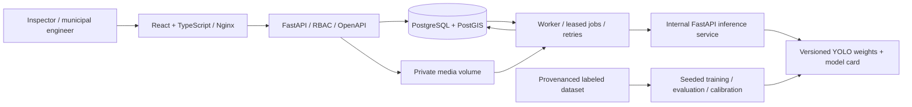

# RoadScope: requirements and architecture

## Scope and assumptions

One organization per deployment. Viewer reads and exports; inspector uploads and reviews; administrator also manages accounts. Coordinates are WGS84 camera locations, NOT surveyed defect positions. UTC timestamps are mandatory. No depth, width in metres, PCI, or certified engineering condition is inferred from monocular images. Rutting is a visible candidate requiring field confirmation. Real inference requires locally provisioned, trusted road-specific weights. Generic COCO weights are rejected by the model class mapping. Synthetic records and synthetic inference are explicitly flagged and excluded from real-only views.

## Architecture

PostgreSQL provides the durable queue: `FOR UPDATE SKIP LOCKED`, expiring leases, heartbeats and fencing tokens. Workers process bounded video frames, send normalized JPEG images over an authenticated internal HTTP connection, and persist observations and canonical defects in one transaction. Failed attempts never commit partial detections. A completed job cannot be replayed without an explicit retry; upload idempotency keys are scoped to users. Run one API process in the local profile; login throttling is stored in the database.

## Data model

* `users`: unique username, Argon2 hash, role, enabled flag, token revision.
* `login_attempts`: hashed client/username bucket and UTC attempt time.
* `jobs`: media SHA-256, private filename, capture metadata, status, progress, attempt count, lease token, expiry and error code. UUID primary keys; unique owner/idempotency key.
* `defects`: class, normalized bounding box, confidence, score and explanation, model identity, camera latitude/longitude/uncertainty, observation time, review state, synthetic flag, duplicate candidate, merged target and road label.
* `observations`: unique job/frame/ordinal, canonical defect foreign key, original detection JSON, capture time and position. This retains evidence when repeats are suppressed.
* `audit_events`: actor, entity, action, before/after details and UTC time. All review, merge, retry and account mutations are audited.

Alembic creates generated `geography(Point,4326)` columns and GiST indexes for defects. API bounding-box queries use that index; candidate searches use `ST_DWithin` in metres. SQLite is exclusively a lightweight test/local fallback; PostGIS integration tests run separately.

## Reliability and interpretation

* File signature/decode validation, upload byte limits, pixel limits, maximum video duration and sampled frame count. Video GPS must cover the sampled duration; gaps over 10 seconds are rejected. No silent fixed GPS fallback for video.
* Preprocessing: EXIF orientation, RGB, bounded longest side, JPEG transport; YOLO handles letterboxing. Boxes and masks are normalized to the oriented source image. No fabricated area in square metres.
* In-frame NMS uses class and box IoU. Cross-frame suppression only associates same-class, overlapping boxes within 5 seconds and 8 metres when GPS uncertainty is at most 15 metres. Association remains an approximation, with all observations retained. Different surveys only generate duplicate candidates; an inspector explicitly merges them. Repaired defects are never auto-merged into a new survey.
* Severity v1 is an explainable visual screening score: class base + bounded image area contribution. Confidence is separate. Optional monotonic calibration maps screening scores to expert ratings; artifacts carry data provenance and held-out error. Calibration does not create metric dimensions or certify PCI.
* Priority = 75% severity + up to 15 points for age (30 days) + 10 for an inspector-marked critical location. This is a policy score, not a predicted repair cost. Repaired, rejected and merged records leave the active queue.
* Health is `100 - mean(active severity)`, labelled an observed-defect indicator. It is null when no active observations exist; that does not imply healthy roads. Sampling bias, unknown coverage and lack of traffic/road-length normalization are shown. No network-wide PCI is claimed.

## Implementation phases / acceptance

1. Requirements: this document, API contract and implementation decisions committed before services.
2. Backend: migrations, auth, upload, geospatial filters, review, exports, audit, job leases; unit/API/PostGIS tests.
3. AI: preprocessing, model adapter, NMS, GPS interpolation, association, version/provenance records, training/evaluation/calibration commands; deterministic fixture tests.
4. UI: responsive map, class/status/source/time/severity filters, inspection panel, jobs/upload, analytics, CSV export and account administration; typecheck and browser tests.
5. Integration/deployment: Compose, service health checks, CI, backup/restore and release gates. See RUNBOOK.md for commands, expected results and troubleshooting per phase.

## Production boundaries

Compose is a development deployment, not an HA installation. Before public operation: deploy TLS/OIDC or hardened password lifecycle, managed PostgreSQL backups/PITR, encrypted object storage with lifecycle rules, malware screening, centrally collected logs, tracing/alerts, rate/size enforcement at ingress, GPU sizing, load/chaos testing, approved tile provider, dataset rights and regional validation. Mount trusted model artifacts read-only; never accept user-uploaded pickle weights. Treat road imagery and GPS as potentially personal data. Review model dependency licensing for the chosen deployment.

